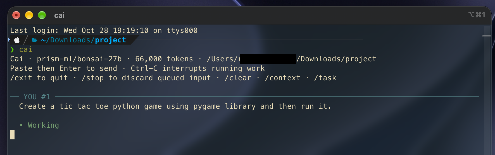

# Cai — Command AI

A terminal assistant for working with files and running programs, powered by models
on your own hardware. Cai connects to **Ollama, LM Studio, or llama.cpp** on the same
computer or an explicitly configured private LAN server. There is no hosted-model fallback.

**Status: alpha.** Tool use and task completion depend on the model, its chat template,
and the resources available to the model server. Cai reports failures and verifies
individual file operations, but it cannot guarantee that an entire task is correct.

## What Cai can do

- Discover available local models and validate active context settings during setup.
- Support context windows of **65,536 tokens and larger**.
- List and search workspace files, read and edit UTF-8 text, and organize directories.
- Run approved programs with explicit arguments, bounded output, and timeouts.
- Verify written/copied file contents and check the path state after other file changes.
- Show numbered conversation turns, explicit approval decisions, and useful error details.
- Track unresolved tool failures and stop repeated calls or unchanged inspection cycles.

Web search, image input, document-format adapters, persistent sessions, automatic undo,
and messaging integrations are planned. See the [improvement roadmap](docs/IMPROVEMENTS.md)
for implemented work, planned features, and their expected performance tradeoffs.

## Quick start

You need Python 3.10+, a running supported model server, and a tool-capable model
with at least 65,536 context tokens. Allow enough memory for both the model and its
context allocation. For LM Studio and llama.cpp, load the model with that allocation
before setup. LM Studio must expose `/api/v1/models`.

From the root of this repository on macOS or Linux:

```sh
python3 -m venv .venv
.venv/bin/python -m pip install -e .
.venv/bin/cai setup
.venv/bin/cai
```

Setup discovers models, checks context settings, and probes structured tool calling
without executing the generated call. Settings are saved in `~/.cai/local.json`.
The editable installation uses this checkout, so keep the repository in place.

For Windows instructions, provider selection, or a model hosted on another computer,
see the [user guide](docs/USAGE.md).

## Use Cai

After activation or [adding Cai to PATH](docs/USAGE.md#make-cai-available-from-any-directory):

```sh
cai
cai chat --workspace ~/Documents/example
cai once "List the files and summarize their organization."
cai once --dry-run "Create notes.txt with a short checklist."
cai --timeout 900
```

Paste a multiline request and press Enter to submit it. Ctrl-C interrupts running
work. Completed file changes remain in place after cancellation or failure.

| Chat command | Purpose |
| --- | --- |
| `/task` | Show operation counts and unresolved failures for the latest task. |
| `/context` | Show the context budget and latest input estimate. |
| `/clear` | Clear conversation history and the current task record. |
| `/stop` or `/cancel` | Discard queued input at the prompt. |
| `/exit` or `/quit` | End the session. |

## Permissions and data

File changes require approval; file permissions may be granted for the current
session. Every program invocation requires separate approval. Dry runs preview
actions without applying them.

File tools enforce workspace boundaries. Approved programs run with your ordinary
OS permissions and can access files and the network: the workspace is **not a
process sandbox**. Automatic rollback is not implemented.

Model connections default to localhost. Private LAN connections require explicit
setup; prompts and relevant tool results then travel to the selected server while
tools still execute on the computer running Cai. API tokens are read from a named
environment variable, not stored in Cai's configuration. Redirects and inherited
HTTP proxies are disabled. HTTP traffic is unencrypted; HTTPS uses certificate
verification. The model server is trusted software and must itself run inference locally.

## Documentation

- [Installation, PATH setup, configuration, and troubleshooting](docs/USAGE.md)
- [Removing the command and uninstalling Cai](docs/USAGE.md#removing-cai)
- [Improvement roadmap and speed tradeoffs](docs/IMPROVEMENTS.md)
- [Architecture and project direction](docs/REMAKE.md)
- [Contributing and development checks](CONTRIBUTING.md)

## License

[MIT](LICENSE).
